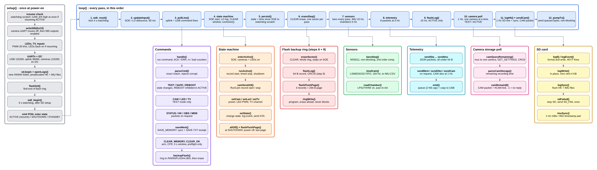

# Flight firmware

RP2040 (Pico) mainboard firmware, v0.3. Pins follow mainboard netlist v5.

```
pio run -e pico -t upload     # build and flash
pio test -e native            # host unit tests (parser, flash record, flash ring, camera parser)
sim/run.sh                    # flight scenarios: real main.cpp on a simulated board (Linux, g++)
```

Compiles for the Pico (82 KB flash, 13.5 KB RAM). Not yet run on the flight board.

## Structure



Source: [`docs/firmware.drawio`](docs/firmware.drawio) (open in [diagrams.net](https://app.diagrams.net) or the draw.io desktop app).

## Layout

- `src/config.h` timeline (SOE, power-off, margins), behaviour switches the team still has to confirm, pins, log sizes. Edit the top block when the timeline is confirmed.
- `src/main.cpp` state machine, sensors, telemetry, SD and flash logging, cameras.
- `src/cmd.h` exact-match command parser.
- `src/flashrec.h`, `src/flashring.h` 64 B flash records and the never-blocking ring buffer.
- `src/camparse.h` RunCam GET_SETTINGS parser (storage left).
- `tools/decode_flash.py` turns a `FLASHn.BIN` backup into CSV.
- `sim/` host simulator: mocks of the Arduino/Pico APIs, fake RXSM, cameras, SD, flash, watchdog, power cuts.

## Behaviour in short

- States BOOT, STANDBY, TEST, ACTIVE, SHUTDOWN, SAFE.
- Timeline: power on T-600 s. `ENTER_TEST_MODE` at T-6:00 is the test: cameras on and recording, LEDs on, checks (GUI, SELF_TEST). `EXIT_TEST_MODE` (or the 5 min timeout) returns to STANDBY and the cameras keep recording. SOE at T-45 s starts the flight clock and sends the final checks as an STS packet plus a `GO` / `NOGO` event. Record-stop T+577 s, all off T+580 s, power-off T+600 s.
- No test (e.g. no uplink): SOE switches the cameras on as a fallback.
- SOE released before LO (hold): back to STANDBY, cameras keep recording, the next SOE starts a fresh flight clock. In TEST, SOE waits until test mode ends and the flight is still timed from the SOE edge.
- After SHUTDOWN, a reset while SOE/LO are still asserted stays in SHUTDOWN until `REARM`. A boot with the signals released goes to STANDBY.
- `CAM_OFF` / `ENTER_SAFE_MODE` stop recording first and cut camera power 3 s later. A watchdog reset during the pre-flight recording keeps the cameras running (`RESUME_REC`).
- Telemetry at 5 Hz: STA, ACT, HK, CH1, CH2, BAR, ACC, GYR. CAM at 1 Hz. MEM and OBS on request.
- SD: per-boot folder `/NNNN`, preallocated contiguous `HK.CSV` and `IMU.CSV`, never deletes files. SD failure is reported once, everything else continues.
- Flash: last 512 KB as a ring buffer, 10 Hz records from SOE. `CLEAR_MEMORY` copies it to SD, then erases it.
- Watchdog reset in ACTIVE resumes ACTIVE and keeps CAM_EN high. Power loss in ACTIVE with SOE/LO still asserted resumes with the time read back from the flash ring.
- REC_START is repeated to any camera whose remaining recording time does not drop (CAM packet `rec` mask).
- TV channel: with no command it cycles through the fitted cameras (10 s each). `TV 0`..`TV 7` holds one camera, `TV 8` resumes cycling; allowed in TEST and ACTIVE (view only, recording is not touched).
- Events are downlinked as `{"t":"EVT","ms":..,"e":"SOE"}` (SOE, SOE_LATE, GO, NOGO, PREFLIGHT_REC, RESUME_REC, LO, REC_OK_n, SYNC_1, UG_START, UG_END, EXP_END, SOE_RELEASED, RESUME_WDT, RESUME_POWER, FLIGHT_DONE_LATCHED, TEST_TIMEOUT, SD_REINIT, I2Cn_RECOVER).

## Flight extras

- **LED sync flash:** all chamber LEDs go dark for 200 ms at SOE+15 s. The exact time is logged and downlinked as `SYNC_1`; finding the dark frames in each video lines all 8 videos up with the sensor data.
- **Microgravity events:** `UG_START` when |a| < 0.05 g for 0.5 s, `UG_END` when |a| > 0.1 g for 0.5 s. Only after LO, logging only.
- **Flight time:** `"tf"` in STA = seconds since SOE (-1 when not flying); the GUI shows SOE+n s and T-time.
- **SELF_TEST:** one `STS` packet with sensors, storage and cameras and GO/NO-GO; GUI button and banner. Run it in test mode with the cameras on for ~10 s so every camera has been polled.

## Not done

- Camera record start/stop uses CAMERA_CONTROL 0x03/0x04 (idempotent). If the cameras only support the 0x01 toggle, the resend logic must not toggle a camera that is already recording.
- Safe Mode is to be removed before SED v4-0.
