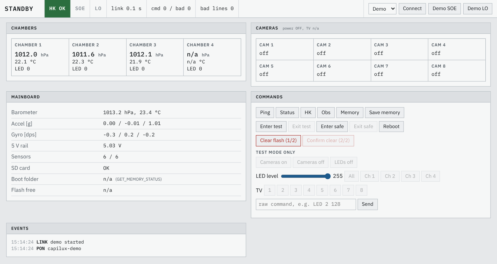
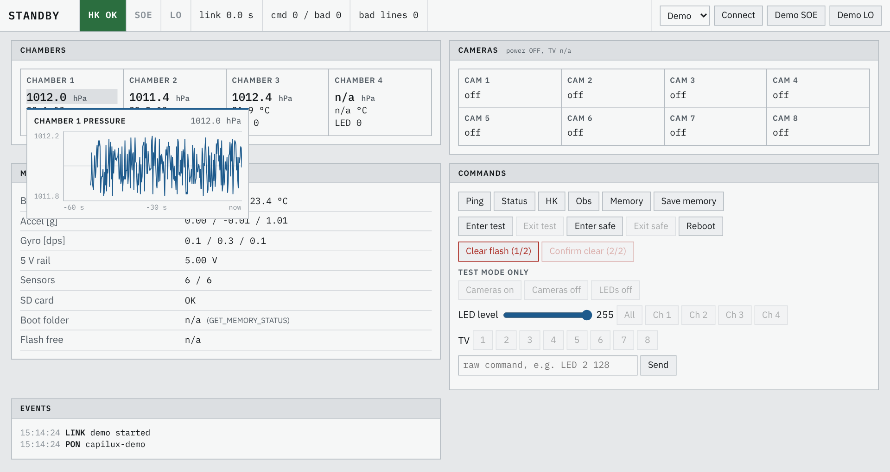
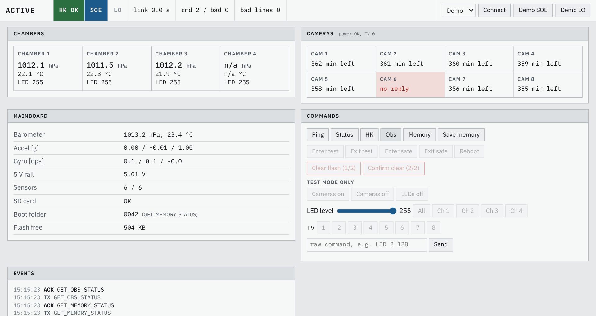

# CAPILUX ground station (demo)

Svelte 5 + Vite. One page, no other dependencies.

```
npm install
npm run dev        # http://localhost:5173
```

Pick **Demo** and press **Connect** to run against a fake mainboard (same packets and
command rules as firmware v0.2). **Demo SOE** / **Demo LO** stand in for the RXSM lines.

## Screenshots

Standby, running against the demo mainboard (chamber 4 sensor missing on purpose):



Hovering a value shows its last minute:



After **Demo SOE**: ACTIVE, cameras on and reporting recording time left (camera 6 not
answering on purpose), test-mode buttons disabled, memory and observation status requested:



## Bridge contract (bridge not written yet)

Pick **Bridge**, enter the WebSocket URL, press **Connect**.

- Bridge to page: one telemetry packet per WebSocket message, the JSON line exactly as the
  firmware sends it, without the newline.
- Page to bridge: one command per message as plain text (e.g. `LED 2 128`). The bridge adds
  `\n` and writes it to the serial port or the Esrange TCP port.

## Files

- `src/App.svelte` - the whole page
- `src/Chart.svelte` - last-minute chart shown in the hover popup
- `src/demo.js` - fake firmware for testing without hardware

Hover (or tap, or focus) any live value to see its last minute as a chart. The page keeps 60 s of
history per value in memory, cleared on Connect. Values older than 2 s are greyed out. Buttons are disabled in states where the firmware
would answer `ERR STATE`.
